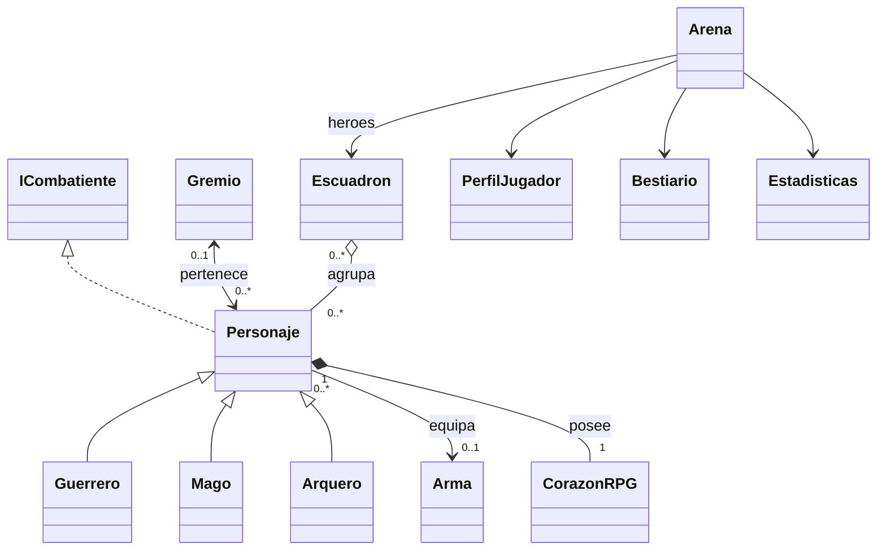

# ArenaRPG — Talleres 7, 8 y 9

El mismo proyecto educativo de consola en Java 21, sin frameworks ni dependencias externas.
Conserva POO, combate por turnos, tablero, inventario genérico y relaciones entre clases.
Ahora integra enumeraciones, conjuntos, mapas y excepciones de dominio.

## Abrir y jugar

1. Abre esta carpeta o pom.xml en IntelliJ IDEA y carga el proyecto Maven.
2. Selecciona JDK 21 en File > Project Structure.
3. Ejecuta org.example.Main con el botón verde de su main.
4. Prepara el escuadrón en el menú; usa **11** para entrar en combate y **6** para salir.

## Opciones del menú

| Opción | Acción |
|---:|---|
| 1 | Crear Guerrero, Mago o Arquero seleccionando TipoPersonaje.values() y nivel 1..20 |
| 2 | Crear gremio |
| 3 | Reclutar personaje existente en el escuadrón inicial |
| 4 | Equipar arma: nombre, daño base 0..1000 y rareza |
| 5 | Tabla de personajes y detalle de corazón, estado, habilidades, arma y gremio |
| 6 | Salir |
| 7 | Unirse o cambiar de gremio |
| 8 | Retirarse del gremio |
| 9 | Desequipar arma |
| 10 | Expulsar del escuadrón sin destruir al personaje |
| 11 | Iniciar el combate existente |
| 12 | Aprender habilidad única, máximo 5 |
| 13 | Registro MANUAL de una victoria de práctica |
| 14 | Consultar bestiario, logros y estadísticas ordenadas |
| 15 | Lanzar hechizo a un enemigo real solicitando costo de maná |
| 16 | Agregar poción con curación base 1..1000 y rareza, hasta 6 en inventario |
| 17 | Ritual de práctica que consume vida y debe dejar al menos 1 |
| 18 | Aplicar VIVO, ENVENENADO o ATURDIDO a un personaje para demostrar efectos |

La opción 13 solo añade un registro al bestiario y su estadística manual: no mata enemigos,
no altera el mapa y no gana una batalla. La opción 15 sí afecta al enemigo real de la arena;
la vida, maná y bajas resultantes se conservan antes de iniciar el combate.
El costo elegido pertenece a la demostración del taller: no hay un sistema de equilibrio comercial.

Dentro del combate: **1** ataca a un enemigo seleccionado, **2** consume la primera poción,
**3** mueve una casilla ortogonal introduciendo columna X y fila Y por separado, ambas 0..4.
No hay límite de distancia para atacar. Las casillas ocupadas por personajes vivos no se atraviesan.
Leyenda: G guerrero, M mago, A arquero, E enemigo, C cofre y . vacío.
Se accede a tablero[y][x]. Un personaje oculta el símbolo del cofre mientras lo ocupa.

## Estructura y conceptos

```text
src/main/java/org/example/
  Main.java                  Inicio y cierre del Scanner principal
  AplicacionArenaRPG.java     Menu, capturas especificas y registros de personajes/gremios
  EntradaConsola.java         InputMismatchException, reintento y finally
  Arena.java                 Tablero, turnos, bajas y control del fallback
  Personaje.java             Clase abstracta, estados, HashSet y relaciones
  Guerrero.java              Escudo y furia
  Mago.java                  Hechizo que propaga SinManaException
  Arquero.java               Flecha precisa
  Arma.java / Pocion.java    Valores base y RaridadItem
  CorazonRPG.java            Unica fuente de salud y mana
  Gremio.java                Asociacion bidireccional sincronizada
  Escuadron.java             Agregacion de personajes existentes
  Inventario.java            Inventario<T> con capacidad y lista protegida
  PerfilJugador.java         TreeSet<String> de logros
  ICombatiente.java          Contrato de defensa
  model/enums/
    TipoPersonaje.java
    EstadoPersonaje.java
    RaridadItem.java
  engine/
    Bestiario.java            HashMap<String, Integer>
    Estadisticas.java         TreeMap<String, Double>
  exception/
    JuegoException.java
    SinManaException.java
    CapacidadExcedidaException.java
    VidaInsuficienteException.java
src/test/java/org/example/
  PruebasArena.java           Regresion del taller 7
  PruebasRelaciones.java      Regresion del taller 8
  PruebasTaller9.java         Enums, Set, Map, excepciones e integracion
```

## UML de las relaciones conservadas



Arma no conoce al dueño. Personaje conoce su gremio y Gremio conoce sus miembros;
altas y bajas iniciadas desde cualquiera de los dos lados quedan sincronizadas.
El personaje puede estar sin gremio (0..1), interpretación coherente con los personajes libres.
Las listas de Gremio y Escuadron son vistas no modificables.

Escuadron recibe personajes ya creados; expulsar o disolver conserva sus atributos,
arma y gremio. Arena utiliza una vista de esa misma lista: no tiene otra lista independiente de héroes.
El registro general del menú conserva referencias a activos, libres y caídos para consultarlos.

Cada Personaje crea su CorazonRPG privado y final en el constructor, sin getter que lo
exponga ni setter que lo reemplace. Salud y maná se almacenan solo allí: los getters del
personaje delegan al corazón. No hay campos duplicados de vida/maná en las subclases.
La composición expresa propiedad y encapsulamiento; asignar null a una referencia no
prueba una recolección inmediata de basura. No se afirma haber observado el recolector.

## Enumeraciones, valores y cálculos

Los siguientes valores completan aspectos que el PDF no fija. Los bonos son **sumas fijas**,
de tipo double privado y final, no porcentajes:

| Tipo | Bono de ataque | Bono de defensa | Creación desde el menú |
|---|---:|---:|---|
| GUERRERO | 1.0 | 1.0 | 120 vida y escudo 10 |
| MAGO | 2.0 | 0.0 | 80 vida y 50 maná |
| ARQUERO | 1.5 | 1.5 | 100 vida, sin maná |

Se utiliza Math.round para obtener enteros; 1.5 se convierte en 2.
El tipo es obligatorio en los constructores y debe coincidir con la subclase.
No se añadió una cadena String tipo: el proyecto anterior no tenía ese campo.

- Daño efectivo del arma = round(dañoBase × multiplicadorRareza).
- Ataque total = round(nivel × 5 + daño efectivo del arma, si existe, + bonoAtaqueTipo).
- Ataque normal utiliza ese total; furia del guerrero lo duplica; hechizo suma 10;
  flecha precisa del arquero suma 5.
- Mitigación del guerrero = escudo + round(bonoDefensaTipo); los demás usan solo el bono.
- Curación efectiva = round(curaciónBase × multiplicadorRareza), limitada a la salud máxima.
- Rarezas: COMUN 1.0, RARO 1.5 y LEGENDARIO 2.5.

Los valores base de armas y pociones no se modifican al consultar ni al usar la rareza.
No se aplica el multiplicador al ataque entero ni se suma dos veces el daño del arma.

Los constructores conservan el parámetro ataqueBase (5..100) de los talleres anteriores:
calculan nivel = ataqueBase / 5 y representan el resto como un arma inicial común.
Así se conservan las bases 16, 12 y 18 de los enemigos. El resultado final cambia por los
bonos nuevos: Thorin 16, Gandalf 27, Orco 17, Brujo 14 y Guardián 19.
Los personajes del menú se crean con nivel × 5 y sin arma.

## Estados y turnos

El estado inicial es VIVO; getVida() > 0 determina que un personaje siga vivo.
ENVENENADO y ATURDIDO son estados de personajes vivos. Al llegar a cero por cualquier daño
se asigna DERROTADO; ninguna opción de cambio de estado ni poción puede resucitarlo.

- ENVENENADO: 5 puntos de daño directo al inicio de cada uno de sus dos próximos turnos,
  sin mitigación de armadura. Puede actuar si sobrevive. Después vuelve a VIVO.
- ATURDIDO: pierde su próximo turno completo (incluye atacar, moverse y usar poción),
  y después vuelve a VIVO. Los ataques directos también rechazan actores aturdidos.
- VIVO: elimina la alteración vigente, sin curar ni revivir.
- Aplicar otro estado sustituye al anterior; no se acumulan alteraciones.
- La opción 18 los aplica antes del combate para demostrarlos sin agregar poderes ajenos al taller.

La actualización se ejecuta una vez por turno para héroes y enemigos, no al imprimir reportes.
Los caídos desaparecen del tablero y salen de las listas fuera de los for-each.

## Set y Map

| Estructura | Uso real |
|---|---|
| HashSet<String> | Libro de hasta 5 habilidades en Personaje; sin orden requerido |
| TreeSet<String> | Logros globales de PerfilJugador, ordenados naturalmente |
| HashMap<String, Integer> | Cantidad de derrotas por nombre de enemigo en engine.Bestiario |
| TreeMap<String, Double> | Contadores globales ordenados: ataques especiales, enemigos derrotados, victorias de arena y registros manuales |

Habilidades y logros recortan extremos, compactan espacios y detectan duplicados ignorando
mayúsculas; conservan la escritura de la primera inserción. El TreeSet ordena esa escritura
mediante el orden natural de String, no mediante un orden lingüístico regional.
Un duplicado de habilidad devuelve false incluso cuando el libro está lleno.
Las habilidades son el registro de aprendizaje pedido por la guía; no añaden otros ataques.

El bestiario normaliza claves a minúsculas con Locale.ROOT y espacios compactados;
rechaza null o vacíos. Usa containsKey y getOrDefault; los reportes recorren entrySet con Map.Entry.
Su orden no está garantizado; el TreeMap sí ordena las estadísticas automáticamente.
No se implementa una tienda: el PDF permite estadísticas como alternativa al catálogo de precios.
Las claves y elementos son String, por lo que no hace falta crear clases ni redefinir equals/hashCode.
Las vistas públicas de conjuntos y mapas son no modificables.

Cada baja real se registra y se retira de la lista de enemigos en la misma limpieza;
reimprimir el tablero o repetir la limpieza no vuelve a contarla. El primer registro
de cada nombre desbloquea «Primera victoria: nombre». Los registros manuales también pueden
desbloquearlo, pero se distinguen de las bajas reales en las estadísticas. Una baja real
posterior incrementa el mismo contador. La victoria final desbloquea «Arena conquistada».

## Excepciones y entrada

```text
Exception
  JuegoException (abstracta)
    SinManaException
    CapacidadExcedidaException
RuntimeException
  VidaInsuficienteException
```

El PDF dice que todas deben heredar de JuegoException y a la vez exige una excepción
no verificada que extienda RuntimeException. No se puede cumplir ambas jerarquías
simultáneamente para VidaInsuficienteException: se respeta su definición específica.

- lanzarHechizo declara y lanza SinManaException si costo > maná actual.
  El costo igual al maná disponible se permite, y un costo negativo se rechaza antes de modificar nada.
- realizarRitual lanza VidaInsuficienteException si costo >= vida; el ritual es una acción
  de práctica que solo consume esa vida, sin recompensas adicionales. Costo cero se permite.
- Inventario.agregar y aprenderHabilidad declaran CapacidadExcedidaException cuando se
  intenta insertar un elemento nuevo y no queda capacidad.
- Las validaciones se realizan antes de consumir recursos. El inventario expone retirar()
  para consumir una poción sin permitir saltarse la capacidad por getItems().
- AplicacionArenaRPG captura cada excepción con su catch y muestra e.getMessage() en System.err.
  Mago propaga el fallo de maná. Solo el controlador de turnos de Arena decide ejecutar un
  ataque básico alternativo tras capturarlo. En la opción 15 se informa el fallo y vuelve al menú.
- Los constructores de excepciones aceptan mensaje y causa. La configuración inicial de
  tres pociones reenvuelve un fallo de capacidad imposible con los límites actuales conservando la causa.

EntradaConsola lee una línea del Scanner principal y utiliza un Scanner auxiliar para validarla
con nextInt. Captura InputMismatchException explícitamente, limpia ese auxiliar con nextLine
y muestra un mensaje en System.err. finally cierra siempre el auxiliar; no cierra el Scanner
principal. Así no quedan saltos de línea pendientes ni se omiten nombres. Texto, decimales,
desbordamientos, líneas vacías y números con texto extra permiten reintentar. EOF cancela la
operación sin crear objetos a medias ni quedarse en un bucle infinito.

## Continuidad de la arena

Se conserva el escuadrón inicial con Thorin y Gandalf, tres enemigos y tres pociones comunes
de 35, 35 y 50. Los reclutas reciben una casilla libre, sin sobrescribir aliados, enemigos o cofre.
Thorin sigue siendo el principal: hay que reclutarlo si fue expulsado.
La victoria exige eliminar enemigos **y** llevarlo al cofre (2,2); la derrota ocurre si cae
Thorin o no quedan héroes vivos. Se permite seguir moviéndose tras eliminar al último enemigo.

Como en el taller 8, hay una batalla por ejecución. Al regresar al menú se conservan personajes,
salud, maná, inventario, gremios, bestiario, perfil y estadísticas en los mismos objetos de Arena.
No hay guardado en disco. Después de iniciar la batalla se bloquean creación, reclutamiento,
expulsión, hechizos de preparación, nuevas pociones, ritual y estados; quedan disponibles reportes,
gremios, armas, habilidades y registros manuales. Otra batalla requiere reiniciar el programa.

## Compilación y pruebas

Desde esta carpeta en PowerShell, con JDK 21 disponible en PATH:

```powershell
New-Item -ItemType Directory -Force target/classes, target/test-classes | Out-Null
$fuentesArena = Get-ChildItem src/main/java -Recurse -Filter *.java
javac -encoding UTF-8 -Xlint:all -d target/classes $fuentesArena.FullName
java -cp target/classes org.example.Main
$pruebasArena = Get-ChildItem src/test/java -Recurse -Filter *.java
javac -encoding UTF-8 -Xlint:all -cp target/classes -d target/test-classes $pruebasArena.FullName
java -cp 'target/classes;target/test-classes' org.example.PruebasArena
java -cp 'target/classes;target/test-classes' org.example.PruebasRelaciones
java -cp 'target/classes;target/test-classes' org.example.PruebasTaller9
```

Son ejecutables main sin JUnit, también ejecutables desde IntelliJ. Maven no los ejecuta
automáticamente con mvn test. PRUEBAS.md detalla resultados y cambios de expectativas;
DEPURACION.md contiene la guía de práctica en IntelliJ, que no se presenta como ejecutada.
