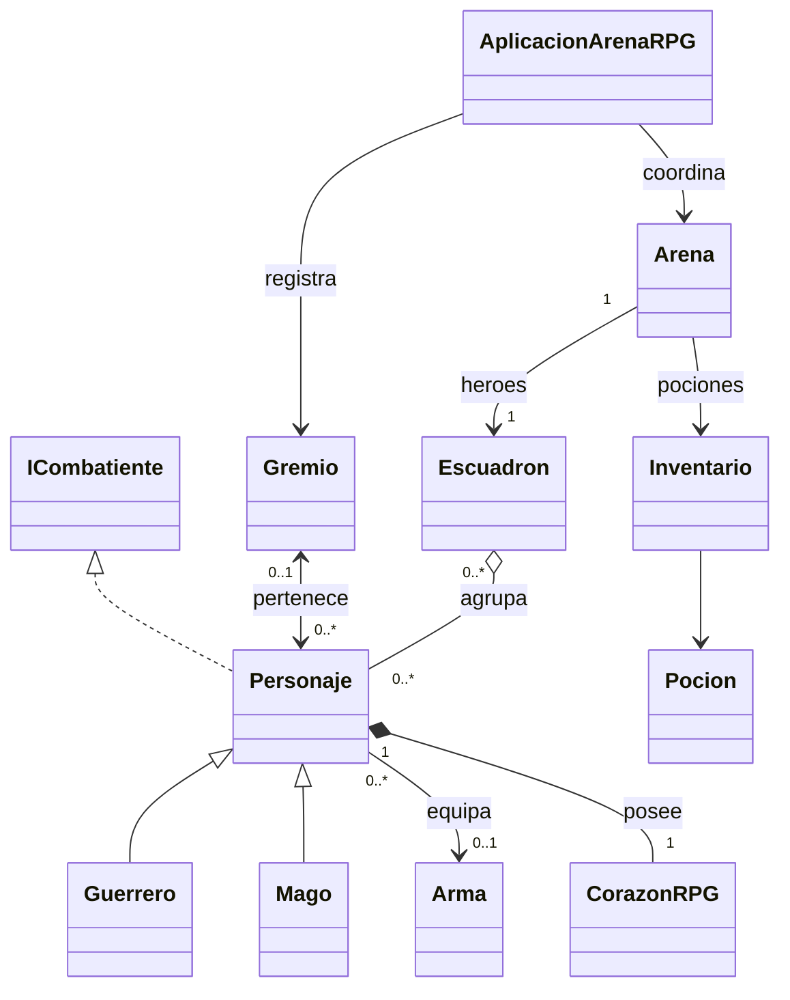

# ArenaRPG — Talleres 7 y 8

Evolución del mismo proyecto de Java 21: POO, colecciones y genéricos (taller 7),
y relaciones entre clases (taller 8). Sin frameworks ni dependencias externas.
Se mantiene el paquete org.example y la configuración Maven existente.
Esta actualización es local; no publica cambios en GitHub.

## Requisitos del taller 8

- Asociación unidireccional con un arma opcional y cálculo de ataque.
- Asociación bidireccional personaje/gremio, sin duplicados ni desincronización.
- Agregación de personajes existentes en un escuadrón.
- Composición: corazón exclusivo creado por cada personaje.
- Menú con Scanner, do-while y switch; reportes con printf y StringBuilder.
- UML con multiplicidades y práctica de diagnóstico en IntelliJ.

## UML



| Relación | Implementación y significado |
|---|---|
| Asociación unidireccional | Personaje guarda Arma; Arma no conoce a su dueño. null significa desarmado. Un arma puede ser referenciada por más de un personaje; no se impone exclusividad que el PDF no pide. |
| Asociación bidireccional | Personaje conoce su gremio, Gremio conoce miembros; altas, bajas y transferencias mantienen los dos extremos. |
| Agregación | Escuadron recibe personajes ya creados. Expulsar o disolver no altera sus atributos ni su gremio. La clase permite que un personaje participe en distintos escuadrones; la aplicación utiliza uno inicial. |
| Composición | Personaje crea un CorazonRPG privado y final. No hay getter del corazón ni setter para sustituirlo; se opera mediante el personaje. |

El PDF dibuja pertenencia a un gremio con multiplicidad 1, pero también admite personajes libres.
Se interpreta como **0..1 gremio por personaje**. No se copia su plantilla literalmente:
Personaje sigue siendo abstracta y se crean Guerrero y Mago, conservando el taller 7.

## Estructura y responsabilidades

```text
ArenaRPG/
  pom.xml
  README.md
  PRUEBAS.md
  DEPURACION.md
  src/main/java/org/example/
    Main.java                  Punto de entrada y cierre del Scanner
    AplicacionArenaRPG.java     Gestion, registro de personajes y gremios
    Arena.java                 Combate, tablero e inventario
    ICombatiente.java          Contrato defender(int)
    Personaje.java             Clase abstracta y relaciones
    Guerrero.java              Escudo y furia
    Mago.java                  Hechizo y consumo de mana
    Arma.java                  Nombre y dano; sin referencia al personaje
    Gremio.java                Lista protegida y sincronizacion bidireccional
    Escuadron.java             Lista protegida de combatientes existentes
    CorazonRPG.java            Salud, mana y limite de curacion
    Inventario.java            Contenedor generico Inventario<T>
    Pocion.java                Curacion delegada al personaje
  src/test/java/org/example/
    PruebasArena.java           24 comprobaciones del taller anterior
    PruebasRelaciones.java      37 comprobaciones de relaciones e integracion
```

## Qué se conserva y qué se adapta

Se conservan los héroes Thorin y Gandalf, los tres enemigos, el tablero 5×5,
ataques polimórficos, sobrecarga de atacar, escudo, hechizo de coste 10,
Inventario<Pocion>, las tres pociones (35,35,50), movimiento y objetivos finales.

La vida y el maná ahora existen únicamente en CorazonRPG: saludBase y manaBase
representan los valores actuales; saludMaxima conserva el límite inicial de curación.
Se retiran los campos duplicados vida, vidaMaxima y puntosMana de Personaje/Mago.
getVida(), getPuntosMana(), curar() y recibirDano() siguen disponibles y delegan al corazón.

El ataque usa **nivel × 5 + daño del arma**. Los constructores conservan su parámetro
ataqueBase para compatibilidad: calculan nivel = ataqueBase / 5 y, si hay resto,
equipan un arma inicial de ese daño. No se conserva otro campo de ataque que pueda desactualizarse.
Los valores aceptados por este constructor son 5..100; el menú pide nivel 1..20 directamente.

| Personaje inicial | Nivel | Arma inicial | Ataque total | Vida | Otro atributo |
|---|---:|---|---:|---:|---|
| Thorin | 3 | Ninguna | 15 | 120 | Escudo 10 |
| Gandalf | 5 | Ninguna | 25 | 80 | Mana 50 |
| Orco | 3 | Daño 1 | 16 | 60 | Escudo 3 |
| Brujo | 2 | Daño 2 | 12 | 45 | Mana 20 |
| Guardián | 3 | Daño 3 | 18 | 70 | Escudo 5 |

El ataque normal usa calcularAtaqueTotal(); la furia duplica ese total y el hechizo
le añade 10. El arma se suma una sola vez. Sin maná se ejecuta el ataque normal.
Equipar sustituye el arma anterior; desequipar deja nivel × 5. Equipar null se rechaza.

## Gestión, escuadrón y combate

Se utiliza un único escuadrón inicial, **Heroes de la Arena**, con Thorin y Gandalf.
Arena consulta una vista no modificable de su lista; no guarda otra lista independiente de héroes.
El registro general del menú mantiene referencias a personajes activos, libres y caídos para
consultarlos, equiparlos y asignarles gremio. No contiene copias de los personajes.

Los personajes nuevos se crean libres (guerrero: 120 vida/escudo 10; mago: 80 vida/50 maná).
Al reclutarlos, Arena les asigna una casilla vacía, evitando enemigos, cofre y aliados.
Se rechazan reclutas caídos, duplicados o sin espacio disponible. Las coordenadas de personajes
libres no significan que estén ocupando el tablero. Los nombres de personajes y gremios son únicos
en el menú, ignorando mayúsculas. Los atributos nuevos son decisiones de implementación.

Expulsar conserva vida, maná, arma, corazón y gremio. Se puede volver a reclutar.
Los caídos se retiran del escuadrón al terminar la ronda mediante removeIf, fuera de los
for-each. Permanecen en el registro general y en su gremio: no hay resurrección automática.
Las vistas de miembros de Gremio y Escuadron no permiten modificaciones externas.

Thorin sigue siendo el principal. Si se expulsa antes de combatir, hay que reclutarlo de nuevo
para iniciar. La victoria requiere eliminar enemigos **y** llevarlo al cofre (2,2).
El combate permite continuar moviéndose después de eliminar al último enemigo.
La derrota ocurre si cae Thorin o no quedan héroes vivos.

El menú permite **una batalla por ejecución**, con los mismos personajes gestionados.
Después devuelve el control al menú y conserva vida, maná, bajas y pociones consumidas.
La creación y cambios de miembros se bloquean después de iniciar esa batalla para no falsear
el resultado; siguen disponibles reportes, armas y gremios. Estos últimos cambios no reabren
el combate. Para preparar otra partida se reinicia el programa. No se guardan partidas en disco.

## Menú y controles

| Opción | Acción |
|---:|---|
| 1 | Crear personaje (Guerrero/Mago, nombre y nivel) |
| 2 | Crear gremio |
| 3 | Reclutar personaje en el escuadrón inicial |
| 4 | Equipar arma (nombre y daño 0..1000) |
| 5 | Ver tabla de estadísticas, corazón, arma, gremio y escuadrón |
| 6 | Salir |
| 7 | Unirse o cambiar de gremio |
| 8 | Retirarse del gremio |
| 9 | Desequipar arma |
| 10 | Expulsar del escuadrón |
| 11 | Iniciar el combate existente |

Dentro del combate: **1** ataca y permite seleccionar enemigo, **2** consume la primera
poción, **3** mueve introduciendo X (columna) e Y (fila), ambos 0..4.
Movimiento ortogonal de una casilla, sin atravesar personajes vivos. Sin límite de alcance de ataque.
Los enemigos atacan automáticamente al primer héroe vivo. Las entradas inválidas no consumen turno.
Una poción a vida completa se consume igualmente; no resucita ni supera la salud máxima.
Fin de entrada interrumpe la operación/partida sin inventar victoria ni derrota.

Leyenda: G guerrero, M mago, E enemigo, C cofre, . vacío. Se usa tablero[y][x].
Un personaje oculta temporalmente el símbolo del cofre al ocuparlo; al salir reaparece.

## Reportes y encapsulamiento

printf produce tablas; StringBuilder construye reportes de Personaje, Arma, Gremio,
Escuadron y CorazonRPG. Personaje muestra solo el nombre del gremio; Gremio y Escuadron
enumeran nombres de miembros, evitando llamadas circulares a toString.

El corazón no se comparte ni se devuelve desde Personaje. La composición representa
propiedad y encapsulamiento, no una orden al recolector de basura. Asignar null a una variable
no prueba que un objeto se haya recolectado inmediatamente; depende de todas sus referencias
y del recolector. Las pruebas verifican identidad y comportamiento, no afirman observar la recolección.

## Abrir y ejecutar

1. Abre esta carpeta o pom.xml en IntelliJ y carga el proyecto Maven.
2. Selecciona JDK 21 en File > Project Structure.
3. Ejecuta org.example.Main mediante el botón verde de su main.
4. Prepara personajes, gremios y armas; usa la opción 11 para jugar.

Para compilar desde PowerShell con JDK 21 en PATH, estando en esta carpeta:

```powershell
New-Item -ItemType Directory -Force target/classes, target/test-classes | Out-Null
$fuentesArena = Get-ChildItem src/main/java -Recurse -Filter *.java
javac -encoding UTF-8 -Xlint:all -d target/classes $fuentesArena.FullName
java -cp target/classes org.example.Main
$pruebasArena = Get-ChildItem src/test/java -Recurse -Filter *.java
javac -encoding UTF-8 -Xlint:all -cp target/classes -d target/test-classes $pruebasArena.FullName
java -cp 'target/classes;target/test-classes' org.example.PruebasArena
java -cp 'target/classes;target/test-classes' org.example.PruebasRelaciones
```

Las pruebas son ejecutables main sin JUnit. También puedes ejecutarlas directamente en IntelliJ.
No se ejecutan automáticamente con mvn test. Consulta PRUEBAS.md para resultados reales y
DEPURACION.md para la práctica en el IDE.
